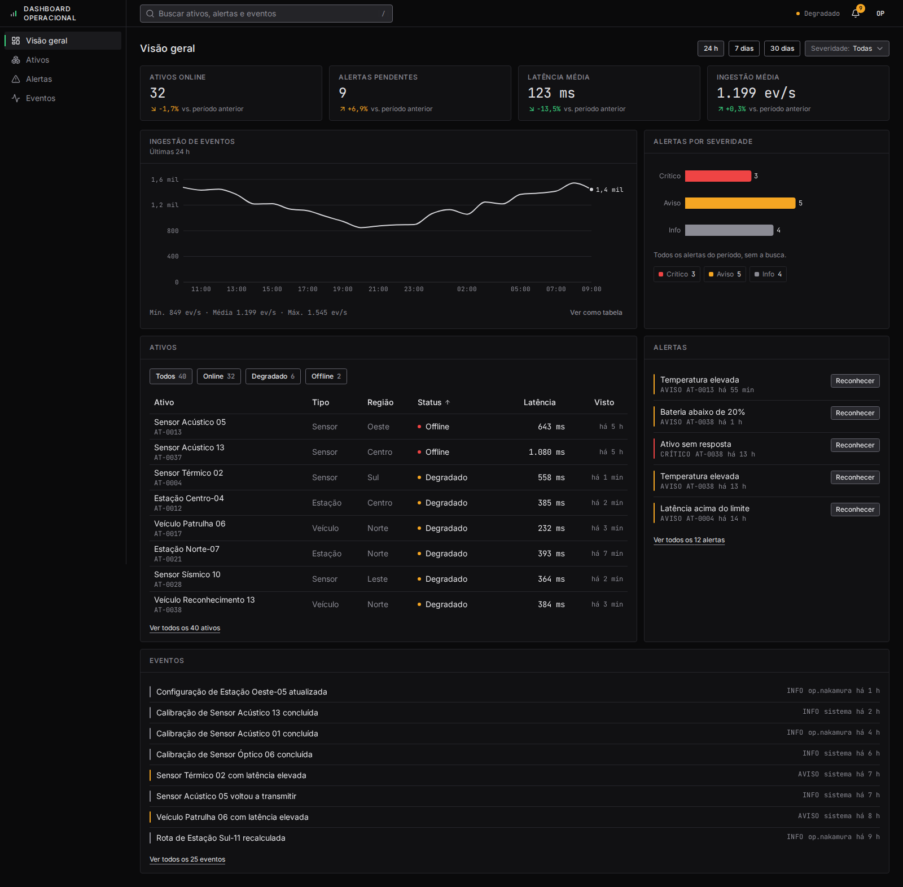

# Dashboard Operacional

Painel web de monitoramento, com tema escuro e foco em dados, para acompanhar numa só tela a saúde de uma frota de sensores, veículos e estações: indicadores, gráficos, ativos, alertas e eventos.

Ainda não há API: o app usa dados fictícios realistas, gerados de forma determinística, que imitam um serviço real (latência, falhas e respostas vazias).



📄 Apresentação completa do projeto: [`docs/apresentacao_projeto.pdf`](docs/apresentacao_projeto.pdf)

## Funcionalidades

- **Indicadores (KPIs):** ativos online, alertas pendentes, latência média e ingestão de eventos, com variação em relação ao período anterior.
- **Gráficos:** ingestão de eventos ao longo do período (com resumo e visão em tabela) e alertas por severidade.
- **Ativos:** tabela com filtro por status (guardado na URL), ordenação por coluna e busca.
- **Alertas:** pendentes primeiro; "Reconhecer" atualiza o KPI de pendentes, o sino de notificações e o status do sistema.
- **Eventos:** feed de atividades com severidade, autor e tempo relativo.
- **Filtros:** período (24 h, 7 dias, 30 dias) e severidade, compartilhados entre as páginas.
- **Busca global:** filtra ativos, alertas e eventos ignorando acentos e maiúsculas. Atalho `/` para focar e `Esc` para limpar.
- **Estados de interface:** carregando, vazio, erro com "Tentar novamente" e dados anteriores preservados quando uma recarga falha.
- **Responsivo e acessível:** menu lateral no celular, uso completo pelo teclado, anúncios para leitores de tela e contraste verificado.

Seções: Visão geral (`/`), Ativos (`/ativos`), Alertas (`/alertas`) e Eventos (`/eventos`).

## Stack

| Área | Ferramentas |
|------|-------------|
| Interface | React 19, TypeScript, React Router |
| Estilo | Tailwind CSS 4, shadcn/ui (Radix), lucide-react |
| Gráficos | Recharts |
| Build | Vite |
| Testes | Vitest, React Testing Library, vitest-axe, Playwright |
| Lint | oxlint |

## Como rodar

Pré-requisito: Node.js 22 (versão fixada em [`.nvmrc`](.nvmrc)).

```bash
nvm use
npm install
npm run dev          # http://localhost:5173
```

### Simular estados

Acrescente ao endereço para ver cada estado da interface:

| Parâmetro | Efeito |
|-----------|--------|
| `?simular=lento` | Resposta em 2 s (estado de carregamento) |
| `?simular=vazio` | Resposta sem dados |
| `?simular=erro` | Falha ao carregar |

## Scripts

```bash
npm run dev          # servidor de desenvolvimento
npm run build        # type-check + build de produção
npm run preview      # servir o build localmente
npm run lint         # oxlint
npm run typecheck    # tsc -b --noEmit
npm test             # Vitest em modo watch
npm test -- --run    # Vitest uma vez
npm run test:e2e     # Playwright (layout, teclado e gráficos no navegador real)
```

Para regerar a apresentação em PDF: `node docs/apresentacao/gerar-pdf.mjs`.

## Estrutura

```
src/
├── components/
│   ├── ui/          # componentes base (shadcn/ui)
│   ├── layout/      # AppShell, Sidebar, Header, menus
│   ├── charts/      # gráficos Recharts (carregados sob demanda)
│   └── dashboard/   # Panel, KPIs, tabela de ativos, alertas, eventos, filtros
├── data/            # API simulada e gerador de dados fictícios
├── hooks/           # filtros, carga de dados, useAsync
├── lib/             # formatação pt-BR, busca, ordenação, rótulos
├── pages/           # seções navegáveis
└── types/           # tipos de domínio
e2e/                 # testes Playwright
docs/                # especificação, plano e apresentação
```

Para ligar o painel a uma API real, troque a origem dos dados em `src/data/api.ts`. O `DashboardDataProvider` também aceita um `fetcher` próprio.

## Documentação

- [`docs/design.md`](docs/design.md): especificação de design
- [`docs/plano.md`](docs/plano.md): plano de implementação e restrições globais
- [`CLAUDE.md`](CLAUDE.md): regras do projeto (testes, commits, idioma)
